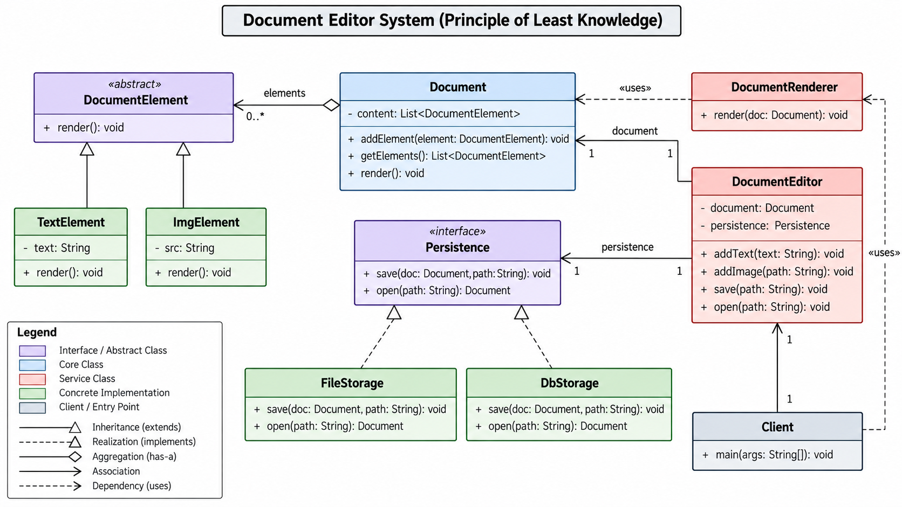
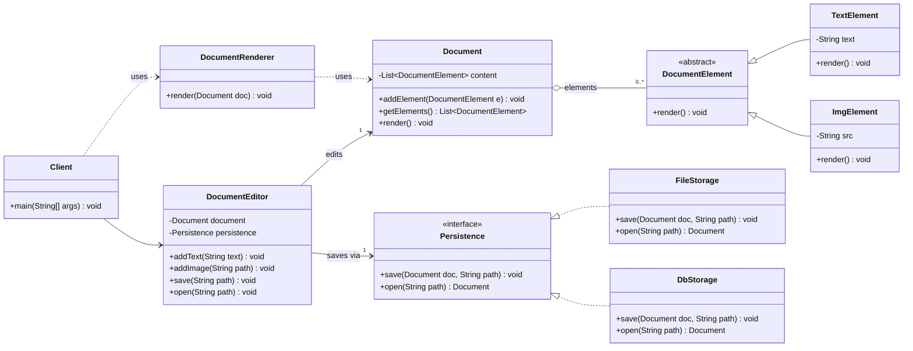

# Google Docs – Document Editor (LLD)

Design a simple document editor: add text and images to a document, render it, and save or open it from different storage backends (file, DB).

**Core principle:** Principle of Least Knowledge (Law of Demeter), plus SRP, OCP and DIP.

## Class Diagram



Fixed vs the UML given in the question:
- `Persistence` only had `save(data: String)`, so `open(path)` was impossible. Now it is an interface with `save(Document, path)` + `open(path)`.
- `Persistence` was drawn as a «uses» dependency, but it is a field of `DocumentEditor`, so it is an association.
- `Persistence` was «abstract» yet drawn with dashed (realization) arrows. Abstract class = solid line, interface = dashed.
- `DocumentElement` is an abstract class here, and `List` replaces `Vector`.

### Same diagram as text (Mermaid)



> Renders on GitHub. In VSCode, the preview needs the "Markdown Preview Mermaid Support" extension.

## Responsibilities

| Class | Job |
|---|---|
| `Client` | Entry point. Talks to `DocumentEditor` only. |
| `DocumentEditor` | Facade for the client. Builds elements, delegates storage. |
| `Document` | Holds an ordered list of elements. Exposes it read-only. |
| `DocumentElement` | Common type for anything that can sit in a document. |
| `TextElement`, `ImgElement` | Concrete elements, each knows how to render itself. |
| `DocumentRenderer` | Renders a document (kept separate so output format can change). |
| `Persistence` | Storage contract. `FileStorage`, `DbStorage` are swappable. |

## Principles Applied

- **SRP**: storing (`Persistence`), rendering (`DocumentRenderer`) and holding content (`Document`) are separate classes.
- **OCP**: new element type = new `DocumentElement` subclass; new storage = new `Persistence` impl. No existing class changes.
- **DIP**: `DocumentEditor` depends on the `Persistence` interface, injected through the constructor.
- **Least Knowledge**: the client calls `editor.addText("hi")`, never `doc.getElements().add(new TextElement("hi"))`.

## Run

No packages are declared, so compile all files together:

```bash
cd 01_Google_doc_design
javac -d out $(find . -name "*.java")
java -ea -cp out Client      # -ea enables the assert checks in Client
```

Expected output:

```
Saving document to file at: notes01.doc
Opening document from file at: notes01.doc
Rendering text: Hello People!!
Rendering text: This is my first try to implement a lld design.
Rendering image: ekImage.png
All checks passed
```

## Mistakes I Made (Revise These)

1. `DocumentEditor extends Document`. Wrong: the editor *has a* document, it *is not* one. Inheritance leaked `addElement`/`getElements` onto the editor.
2. Called `document.addText()` / `addImg()`, which don't exist. The editor should create the element and call `document.addElement(...)`.
3. `getElements()` returned the internal list. Return `Collections.unmodifiableList(...)` instead.
4. `new List<>()` doesn't compile: `List` is an interface, use `new ArrayList<>()`.
5. Public class name must match the file name (`Client` in `Client.java`).
6. Passed `new Document()` to the editor but rendered a different `doc`. Always pass the same instance you check.
7. Forgot `DocumentRenderer` from the original UML.

## Open Gaps / Interview Follow-ups

- After `editor.open()`, the editor holds a new `Document` but the client's `doc` reference is stale. Fix: `editor.render()` or `editor.getDocument()`.
- `FileStorage`/`DbStorage` only print. Who serializes a `Document` to text? (Elements need something like `serialize()`.)
- Every new element type adds an `addX()` method to `DocumentEditor`. Is the editor really closed for modification?
- Undo/redo: Command pattern.
- Multiple users editing one doc: `Vector`/locks aren't enough; real answer is OT or CRDT.
- Abstract class vs interface: `DocumentElement` has no state, so an interface would do.
