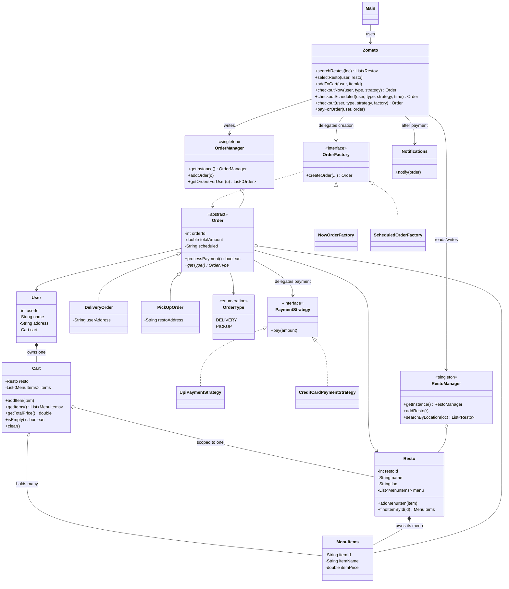

# Architecture

## 1. Layers

Dependencies point **downward only**. Nothing in `models/` knows the facade
exists; nothing in `strategies/` knows about orders.

```
        ┌──────────────────────────────────────────┐
        │  Main.java            (client)           │   knows: Zomato + models
        └────────────────────┬─────────────────────┘
                             │
        ┌────────────────────▼─────────────────────┐
        │  Zomato.java          (FACADE)           │   sequences the use cases,
        └──┬──────────┬───────────┬─────────────┬──┘   owns no data
           │          │           │             │
     ┌─────▼────┐ ┌───▼──────┐ ┌──▼─────────┐ ┌─▼──────────┐
     │ managers │ │factories │ │ strategies │ │  services  │
     │(singleton│ │ (create  │ │  (how to   │ │  (notify)  │
     │ storage) │ │  orders) │ │    pay)    │ │            │
     └─────┬────┘ └───┬──────┘ └──┬─────────┘ └─┬──────────┘
           │          │           │             │
        ┌──▼──────────▼───────────▼─────────────▼──┐
        │  models/     (plain data + its own rules)│
        └──────────────────────────────────────────┘
```

| Layer | Responsibility | Must **not** do |
|---|---|---|
| `Main` | build the app, drive a scenario | reach a manager or factory directly |
| `Zomato` (facade) | order the steps of a use case | hold collections, format money, know payment internals |
| `managers/` | own the collections, search them | create orders, print notifications |
| `factories/` | decide which `Order` subclass to build and with what timestamp | store orders |
| `strategies/` | one payment channel each | know what an `Order` is |
| `services/` | side effects after the fact (notify) | mutate the order |
| `models/` | state + the rules that only need their own fields | talk to managers/services |

## 2. Class diagram



## 3. How the entities connect — and why

Read this as "who points at whom, and who is allowed to delete whom".

**`User` ──owns──> `Cart` (composition, 1:1).** The `cart` field is `final` and
built in the `User` constructor. A cart has no meaning without its user and dies
with it. There is no `setCart`, so the user's cart identity never changes —
that is what lets the facade write `user.getCart()` everywhere without checking
for null.

**`Cart` ──references──> `Resto` (0..1).** A cart belongs to **one** restaurant
at a time, because a single order cannot be split across kitchens. This is the
rule behind two guards: `addItem` refuses to add anything while `resto == null`,
and `isEmpty()` is true when either the restaurant or the item list is missing.
`clear()` resets both, so the next order starts from "pick a restaurant".

**`Resto` ──owns──> `MenuItems` (1:N, composition).** The menu is the
restaurant's data, so lookups live there (`findItemById`) rather than in the
facade. The cart and the order then hold *references* to the same `MenuItems`
objects — they do not copy dish data.

**`Cart` ──holds──> `MenuItems` (N, aggregation).** `getItems()` hands back
`List.copyOf(items)`: callers get the same dish objects but their own list. That
one decision is what keeps a placed order intact when the cart is cleared after
payment.

**`Order` ──references──> `User`, `Resto`, `List<MenuItems>`, `PaymentStrategy`.**
An order is a *snapshot of a decision*: who, from where, what, how much, when,
and by what payment channel. It is deliberately not reachable from `User` or
`Resto` — the links are one-directional, so there is one place to look when an
order changes: `OrderManager`.

**`Order` ◁── `DeliveryOrder` / `PickUpOrder`.** The two differ in exactly one
field: a delivery order remembers the *user's* address, a pickup order the
*restaurant's*. Everything else (id, items, total, schedule, `processPayment()`)
is shared, so it lives in the abstract base. `getType()` is abstract, which is
what removes `if (order instanceof ...)` from the rest of the system — the
notification and the order listing just call `getType()`.

**`Order` ──delegates──> `PaymentStrategy`.** `processPayment()` checks that a
strategy exists and calls `pay(total)`. Adding net-banking or a wallet does not
touch `Order`.

**`OrderFactory` ──creates──> `Order`.** The factory is the only place that
knows "DELIVERY means build a `DeliveryOrder` and stamp the user's address on
it". The facade asks for an order and gets one fully wired.

**`RestoManager` / `OrderManager` ──own──> the collections.** They are the
single source of truth. The facade queries them; it never keeps a parallel list.

## 4. Flow of a "deliver now" order

```
Main                 Zomato            Cart/User     NowOrderFactory   OrderManager   Strategy  Notifications
 │                     │                  │                │               │             │          │
 │ searchRestos("Delhi")                  │                │               │             │          │
 ├────────────────────>│ RestoManager.searchByLocation ──> [Bikaner]       │             │          │
 │                     │                  │                │               │             │          │
 │ selectResto(u, r)   │                  │                │               │             │          │
 ├────────────────────>├── cart.setResto(r) ──>│           │               │             │          │
 │                     │                  │                │               │             │          │
 │ addToCart(u, "P1")  │                  │                │               │             │          │
 ├────────────────────>├── resto.findItemById("P1") ──> MenuItems          │             │          │
 │                     ├── cart.addItem(item) ─>│          │               │             │          │
 │                     │                  │                │               │             │          │
 │ checkoutNow(u, DELIVERY, UPI)          │                │               │             │          │
 ├────────────────────>│                  │                │               │             │          │
 │                     ├── cart.isEmpty()? ───>│  (guard: no order on an empty cart)     │          │
 │                     ├── createOrder(user, resto, items, strategy, total, DELIVERY) ─> │          │
 │                     │                  │                ├── new DeliveryOrder()       │          │
 │                     │                  │                ├── setUserAddress(u.address) │          │
 │                     │                  │                ├── set user/resto/items/…    │          │
 │                     ├<───────────────── Order ──────────┤               │             │          │
 │                     ├── addOrder(order) ───────────────────────────────>│             │          │
 │<─────── Order ──────┤                  │                │               │             │          │
 │                     │                  │                │               │             │          │
 │ payForOrder(u, order)                  │                │               │             │          │
 ├────────────────────>├── order.processPayment() ──────────────────────────────────────>│          │
 │                     │                  │                │               │  pay(135.0) │          │
 │                     ├── (true) notify(order) ───────────────────────────────────────────────────>│
 │                     ├── cart.clear() ──>│   (order keeps its own item snapshot)       │          │
```

The two branch points in that flow are the whole design:

- **which `Order` to build** → answered by the factory, not by an `if` in the facade;
- **how to charge** → answered by the strategy, not by an `if` in `Order`.

## 5. SOLID, mapped to this code

| Principle | Honoured by | Violated / compromised by |
|---|---|---|
| **S**ingle responsibility | `Cart` (basket maths), `Notifications` (output), `TimeUtils` (clock), each strategy | `Zomato` is a wide facade — acceptable, but it grows with every use case |
| **O**pen/closed | a new payment channel = one new `PaymentStrategy`; a new order timing = one new `OrderFactory`, both with **zero** edits to existing classes | `OrderAssembler.newOrderOfType` switches on `OrderType`, so a *third* fulfilment type (dine-in) means editing it |
| **L**iskov substitution | anything taking an `Order` works with either subclass; `getType()` is total | — |
| **I**nterface segregation | `PaymentStrategy` has one method; `OrderFactory` has one method | — |
| **D**ependency inversion | `Order` depends on the `PaymentStrategy` *interface*; `Zomato` depends on the `OrderFactory` *interface* | `Zomato` calls `RestoManager.getInstance()` / `OrderManager.getInstance()` — a hard dependency on concrete singletons. Constructor injection would fix it and make the facade testable |

## 6. Where to extend it next

Each row is a self-contained exercise; the "touches" column is the honest blast radius.

| Feature | Pattern | Touches |
|---|---|---|
| Order lifecycle (PLACED → PREPARING → DELIVERED) | **State** | new `OrderState` hierarchy + a field on `Order` |
| Coupons, taxes, delivery fee, surge | **Decorator** or a `PricingRule` chain | pull totalling out of `Cart`/`Order` into a `PricingEngine` |
| SMS + email + push notifications | **Observer** | `Notifications` becomes a subject with subscribers |
| Assign a delivery partner | **Strategy** (nearest / cheapest / fastest) | new `DeliveryPartner` model + `AssignmentStrategy` |
| Dine-in as a third fulfilment type | extend the factory switch, or a `Map<OrderType, Supplier<Order>>` | `OrderType`, `OrderAssembler`, one new `Order` subclass |
| Search by cuisine / rating / price | keep in `RestoManager`, add a `Predicate<Resto>` filter | `RestoManager`, `Resto` |
| Restaurant open/closed hours | a rule on `Resto`, checked in `checkout` | `Resto`, `Zomato.checkout` |
